

  
  


<a href="https://github.com/anmol9910/Synapse-Agent-Fabric"></a>

<a href="https://github.com/anmol9910/ai-product-inventor"></a>

<a href="https://github.com/anmol9910/montecarlo-portfolio-management-model"></a>

<a href="https://github.com/anmol9910/Stress-testing-financial-model-for-portfolio"></a>

<a href="https://github.com/anmol9910/Sentiment-Analysis-with-BERT-Transformers"></a>

<a href="https://github.com/anmol9910/Customer-Churn-Analysis"></a>

<a href="https://github.com/anmol9910/i95dev-ai-assessment-anmol"></a>




<b>Show the other 16 repositories</b>

 

| Project | Domain | Stack |
|---|---|---|
| [histopathologic-cancer-detection](https://github.com/anmol9910/histopathologic-cancer-detection) | Deep Learning | Jupyter Notebook |
| [BRAIN-TUMOR-PROJECT](https://github.com/anmol9910/BRAIN-TUMOR-PROJECT) | Deep Learning | Jupyter Notebook |
| [computer-vision-assessment-iisc](https://github.com/anmol9910/computer-vision-assessment-iisc) | Computer Vision | Jupyter Notebook |
| [AI-Voice-Agent-Automation-Workflow](https://github.com/anmol9910/AI-Voice-Agent-Automation-Workflow) | AI Agents | Workflow automation |
| [Fake-Job-Post-Detection-NLP](https://github.com/anmol9910/Fake-Job-Post-Detection-NLP) | NLP | Jupyter Notebook |
| [search-engine-optimization-using-nlp](https://github.com/anmol9910/search-engine-optimization-using-nlp) | NLP | Jupyter Notebook |
| [stock-visualization-and-forcasting-using-dash](https://github.com/anmol9910/stock-visualization-and-forcasting-using-dash) | Finance | Python, Dash |
| [blockhouse-work-trial-task-solution](https://github.com/anmol9910/blockhouse-work-trial-task-solution) | Finance | Jupyter Notebook |
| [-credit-card-fraud-detection-using-ml](https://github.com/anmol9910/-credit-card-fraud-detection-using-ml) | Machine Learning | Jupyter Notebook |
| [ecommerce-sales-forecasting](https://github.com/anmol9910/ecommerce-sales-forecasting) | Forecasting | Jupyter Notebook |
| [Vehicle-Registrations-Investor-Dashboard](https://github.com/anmol9910/Vehicle-Registrations-Investor-Dashboard) | Dashboard | Python |
| [Bangalore-house-price-prediction](https://github.com/anmol9910/Bangalore-house-price-prediction) | Machine Learning | Jupyter Notebook |
| [Exploratory-Analysis-of-Geolocational-Data-using-Python](https://github.com/anmol9910/Exploratory-Analysis-of-Geolocational-Data-using-Python) | Data Analysis | Jupyter Notebook |
| [AWS_CRC](https://github.com/anmol9910/AWS_CRC) | Cloud | AWS |
| [keploy-docs](https://github.com/anmol9910/keploy-docs) | Open Source | MDX |
| [bug-tracker](https://github.com/anmol9910/bug-tracker) | Software | Hack |




  
  

